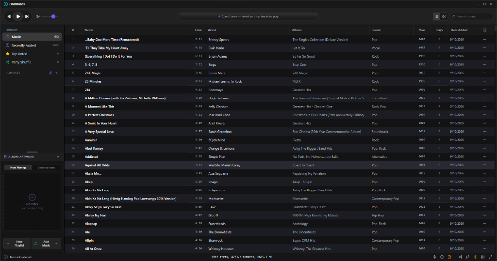

<div align="center">
  
  <h1>ClassiTunes</h1>
  <p><strong>A nostalgic, high-performance desktop music player, metadata organizer, and hardware device synchronizer</strong></p>
  <p>Engineered with React 19, TypeScript, Vite, Tailwind CSS, and Tauri v2 (Rust).</p>

  <p>
    <a href="#key-features">Features</a> •
    <a href="#hardware-device-synchronization">Device Sync</a> •
    <a href="#supported-audio-formats">Formats</a> •
    <a href="#device--os-compatibility">Compatibility</a> •
    <a href="#installation--running">Installation</a> •
    <a href="#development--building">Building</a> •
    <a href="#technical-architecture">Architecture</a> •
    <a href="#keyboard-shortcuts">Shortcuts</a> •
    <a href="#license">License</a>
  </p>

  <br />
  
</div>

---

## Overview

**ClassiTunes** brings the golden era of classic desktop jukeboxes into the modern era. Combining the beloved, clean aesthetic of classic brushed metal and dark interface styling with high-performance native desktop capabilities, ClassiTunes offers local library indexing, gapless audio playback, a 10-band graphic equalizer, physical metadata tagging, smart playlist automation, and seamless hardware device synchronization (iPods, MP3 players, and Android DAPs).

Available as a native desktop application powered by **Tauri v2** (ultra-lightweight Rust backend) with a zero-telemetry, 100% local-first design.

---

## Key Features

### 🎵 High-Fidelity Audio Engine
- **Cross-Platform Playback:** Gapless audio pipeline with high-precision seeking, customizable volume curves, shuffle, and single/all repeat modes.
- **Audio Normalization:** Consistent perceived loudness across diverse tracks and masters.
- **Adjustable Crossfading:** Seamless track transitions with configurable 1–12 second crossfade durations.
- **10-Band Graphic Equalizer:** 32 Hz to 16 kHz frequency control with pre-amp gain and 17 handcrafted presets (*Acoustic*, *Bass Booster*, *Rock*, *Classical*, *Electronic*, *Jazz*, *Vocal Booster*, and more).
- **Interactive Visualizers:** Real-time audio spectrum analysis featuring *Classic Bars*, *Laser Wave*, *Frequency Ring*, and *Cosmic Particles*.

### 🏷️ Native Metadata & Tag Editor ("Get Info")
- **Inspect & Edit Full ID3 & MP4 Metadata:** Modify Title, Artist, Album Artist, Album, Composer, Publisher, Year, Track Number & Total, Disc Number & Total, BPM, Genre, Media Kind, and Comments.
- **Direct Physical Tag Writing:** 
  - **MP3 & ADTS AAC:** ID3v2 tagging with embedded JPEG/PNG album art support.
  - **M4A, M4B, MP4:** Native MP4 `ilst` atom tagging via Rust `mp4ameta`.
  - **FLAC & OGG:** Native Vorbis comment tagging.
- **Embedded Artwork Manager:** Extract, replace, paste, preview, or remove embedded track album art with automatic multi-size scaling.
- **Lyrics Inspector:** Embedded synchronized and unsynchronized lyrics viewer and editor.
- **AI Track Insights:** Optional Google Gemini AI integration to summarize song lyrics, explore artist discography, and suggest complementary tracks.

### 📁 Library Management & Smart Playlists
- **Multiple Browsing Modes:** Switch smoothly between **Detailed List View** (with sortable columns, star ratings, play counts) and **Album Grid View** with high-resolution artwork cards.
- **Large-Library Architecture (10,000+ tracks):** Instant sub-millisecond filtering via in-memory search index, memoized state reducers, and high-performance virtual scrolling.
- **Crash-Safe Journaled Database:** Combines atomic snapshot state (`library_db.bin`) with an append-only mutation journal (`library_journal.bin`) and auto-compaction.
- **Scoped Context Search:** Conducting a search scopes dynamically to your active view (active playlist, smart playlist, folder, or connected device contents).
- **Smart Rule-Based Playlists:** Create automated playlists matching "All" or "Any" conditions across artists, genres, star ratings, years, play counts, or custom keywords (e.g., *Top Rated Songs*, *90s Rock Favorites*).
- **Disk Auto-Organizer:** Automatically organize audio files into standard hierarchical directories:
  ```
  <Music Directory>/<Artist>/<Album>/<TrackNumber> - <Title>.<ext>
  ```
- **Drag & Drop Import:** Drag music files or entire folder trees directly into the library window.

---

## Hardware Device Synchronization

ClassiTunes features a dedicated **Device Manager** modeled after classic desktop jukebox synchronizers, equipped with a segmented glass capacity meter (Audio, Other, Free, and Pending Sync).

- **Supported Device Types:**
  - **Apple iPods:** Full support for classic click-wheel and screenless iPods (Classic, Mini, Nano, Video, Shuffle). Parses and writes native binary `iTunesDB` with checksum hashes (`Hash58`/`Hash72`).
  - **Generic MP3 Players & DAPs:** Sony Walkman, SanDisk Sansa, FiiO, Shanling, Astell&Kern, Cowon, Rockbox, and generic USB mass storage drives.
  - **Android Devices (MTP):** Direct MTP communication on Windows for seamless synchronization to internal phone storage or SD cards.
- **Smart Incremental Differential Sync:**
  - **No Duplicate Songs:** Tracks are indexed by path and identity `(artist, title)`. Files will not be duplicated if paths or naming conventions vary slightly.
  - **Zero-Waste Re-use:** Tracks already on the device with matching audio are skipped with 0 bytes transferred.
  - **In-Place Tag Updates:** If a song's rating, tags, or album cover are modified in your library, ClassiTunes updates the tags on the device in-place without re-transcoding or re-copying the audio stream.
  - **Mirror Sync:** Songs removed from your sync playlist or selection are pruned cleanly from the device.
- **On-The-Fly Audio Transcoding:** Automatically convert high-res lossless FLAC, ALAC, WAV, or AAC to portable MP3 or AAC (128–320 kbps), with optional mono downmixing and 44.1 kHz downsampling.
- **Scoped Device Search:** Search directly within the contents of connected devices in the "Device Contents" tab.

---

## Supported Audio Formats

| Format | Extensions | Playback | Metadata Tagging | Cover Art Extraction |
| :--- | :--- | :---: | :---: | :---: |
| **MPEG Audio Layer III** | `.mp3` | ✅ | ID3v2.3 / ID3v2.4 | ✅ |
| **Advanced Audio Coding** | `.m4a`, `.aac`, `.mp4` | ✅ | MP4 `ilst` / ID3 | ✅ |
| **Free Lossless Audio Codec** | `.flac` | ✅ | Vorbis Comment | ✅ |
| **Waveform Audio** | `.wav` | ✅ | ID3 / RIFF INFO | ✅ |
| **Ogg Vorbis** | `.ogg` | ✅ | Vorbis Comment | ✅ |
| **Apple Lossless** | `.alac`, `.m4a` | ✅ | MP4 `ilst` | ✅ |
| **Audio Interchange Format** | `.aiff`, `.aif` | ✅ | ID3 | ✅ |
| **Windows Media Audio** | `.wma` | ✅ | ASF Tags | ✅ |

---

## Device & OS Compatibility

| Host Operating System | USB Mass Storage (MSC) | iPod `iTunesDB` | Android (MTP) | Audio Subsystem |
| :--- | :---: | :---: | :---: | :--- |
| **Windows 10 / 11** | ✅ (`GetLogicalDriveStringsW`, `IOCTL_STORAGE_QUERY`) | ✅ (FAT32) | ✅ (Native Shell WPD COM) | WASAPI / DirectSound |
| **macOS 12+ (Intel & Apple Silicon)** | ✅ (Mounted `/Volumes`) | ✅ (FAT32 & HFS+) | ⚠️ (Requires OS MTP mount) | CoreAudio |
| **Linux (Ubuntu, Fedora, Arch, etc.)** | ✅ (`udisks2`, `/media`, `/run/media`) | ✅ (FAT32) | ✅ (GVFS / KIO / `jmtpfs`) | PipeWire / PulseAudio / ALSA |

> [!NOTE]
> **iPhones & Modern iOS Devices:** iOS enforces strict sandbox encryption and proprietary MobileDevice pairing (`usbmuxd`) on its internal music database (`MediaLibrary.sqlite`). ClassiTunes is focused on open, standards-compliant digital audio players (iPods, Walkmans, DAPs, USB drives, Android) and does not support direct sync to locked-down iPhones.

---

## Installation & Running

### Windows

#### 1. Installer or Portable Binary
1. Download `ClassiTunes_<version>_x64-setup.exe` or portable archive from [Releases](https://github.com/Z-Sofware-Labs/ClassiTunes/releases).
2. Run the installer or extract and launch `ClassiTunes.exe`.

> [!NOTE]
> **Windows SmartScreen Notice:**  
> Because ClassiTunes is an open-source project without an enterprise EV certificate, Windows Defender SmartScreen may display:  
> *"Windows protected your PC — Microsoft Defender SmartScreen prevented an unrecognized app from starting."*  
> To launch: Click **More info** $\rightarrow$ **Run anyway**.

---

### macOS

#### 1. DMG Disk Image
1. Download `ClassiTunes_<version>_universal.dmg` from [Releases](https://github.com/Z-Sofware-Labs/ClassiTunes/releases).
2. Open the `.dmg` image and drag **ClassiTunes** into your `/Applications` directory.
3. Launch **ClassiTunes** from Spotlight or Launchpad.

> [!NOTE]
> **macOS Gatekeeper First-Time Notice:**  
> If macOS displays an alert that the developer cannot be verified:  
> 1. In **Finder**, navigate to `/Applications`.  
> 2. **Right-click (or Control-click)** `ClassiTunes` and select **Open**.  
> 3. Click **Open** in the prompt.  
> 
> *Alternatively via Terminal:*
> ```bash
> xattr -cr /Applications/ClassiTunes.app
> ```

---

### Linux

#### Debian / Ubuntu (`.deb`)
```bash
sudo dpkg -i ClassiTunes_*_amd64.deb
sudo apt-get install -f # Resolve any missing dependencies
```

#### Fedora / RHEL (`.rpm`)
```bash
sudo dnf install ./ClassiTunes-*.rpm
```

#### AppImage
```bash
chmod +x ClassiTunes-*.AppImage
./ClassiTunes-*.AppImage
```

> [!TIP]
> **Linux Codec Dependencies:**  
> Ensure GStreamer audio decoders are present for MP3 and AAC playback:
> - **Ubuntu / Debian:** `sudo apt install -y gstreamer1.0-plugins-base gstreamer1.0-plugins-good gstreamer1.0-plugins-bad gstreamer1.0-libav`
> - **Fedora:** `sudo dnf install -y gstreamer1-plugins-good gstreamer1-plugins-bad-free`
> - **Arch Linux:** `sudo pacman -S --needed gst-plugins-good gst-plugins-bad gst-libav`

---

## Development & Building

### Prerequisites
- [Node.js](https://nodejs.org/) (v20 or higher recommended)
- [Rust & Cargo](https://rustup.rs/) (latest stable)
- **C++ Platform Tools:**
  - **Windows:** Visual Studio 2022 C++ Build Tools
  - **macOS:** Xcode Command Line Tools (`xcode-select --install`)
  - **Linux:** `build-essential`, `libwebkit2gtk-4.1-dev`, `libssl-dev`, `libayatana-appindicator3-dev`, `librsvg2-dev`

### 1. Clone & Install
```bash
git clone https://github.com/Z-Sofware-Labs/ClassiTunes.git
cd ClassiTunes
npm install
```

### 2. Environment Configuration (Optional)
For Google Gemini AI song insights and lyric analysis:
```bash
cp .env.example .env.local
```
Add your API key:
```env
GEMINI_API_KEY="your-gemini-api-key-here"
```

### 3. Development Commands

| Command | Description |
| :--- | :--- |
| `npm run dev` | Runs the Vite frontend development server (`http://localhost:3000`) |
| `npm run tauri:dev` | Launches the complete Tauri desktop application in live reload mode |
| `npm run build` | Compiles the production frontend bundle via Vite |
| `npx tsc --noEmit` | Runs full TypeScript static type checking |
| `cargo test --manifest-path src-tauri/Cargo.toml --lib` | Executes the native Rust unit and integration test suite |

### 4. Production Packaging

```bash
# Builds complete platform installers (NSIS/MSI, DMG, DEB/RPM/AppImage)
npm run tauri:build
```
Compiled installers and release artifacts are generated under `src-tauri/target/release/bundle/`.

---

## Technical Architecture

```
ClassiTunes/
├── src/                          # Frontend Application (React 19 + TypeScript + Vite)
│   ├── components/               # UI components (ListView, AlbumGrid, DeviceManagerView, HeaderBar)
│   ├── services/                 # Audio engine, database storage, device sync, metadata bridges
│   ├── types/                    # Core TypeScript definitions (Track, Playlist, Mp3Device)
│   └── utils/                    # Smart playlist evaluator, search indexer, formatters
└── src-tauri/                    # Native Backend (Rust + Tauri v2)
    ├── src/
    │   ├── lib.rs                # Tauri entry point, command dispatchers, window setup
    │   ├── db.rs                 # Crash-safe binary database snapshot & mutation journal
    │   ├── mp3_device.rs         # USB mass storage, MTP, differential sync & iPod iTunesDB
    │   ├── audio_engine.rs       # Native DSP, volume curves, and equalizer filters
    │   ├── transcoder.rs         # Multi-threaded audio conversion & downsampling
    │   └── itunes_db.rs          # iPod iTunesDB parser and binary serializer with Hash58
    └── Cargo.toml                # Rust dependencies and compiler optimizations
```

- **Crash-Resistant Persistence:** Changes to ratings, play counts, or track metadata append atomically to `library_journal.bin`. The snapshot (`library_db.bin`) is rewritten safely using atomic temporary file swaps, guarding against data corruption during unexpected power cuts.
- **In-Memory Search Key Indexing:** Tracks are pre-indexed into a normalized lookup map (`title`, `artist`, `album`, `genre`), allowing instant, stutter-free filtering over 10,000+ tracks.
- **Safe Concurrency:** Sync actions use `SyncActiveGuard` and OS sleep inhibitors (`SetThreadExecutionState` on Windows, `caffeinate`/IOPMAssertion on macOS) to prevent laptops from entering sleep mode midway through a file transfer.

---

## Keyboard Shortcuts

| Shortcut | Action |
| :--- | :--- |
| <kbd>Space</kbd> | Play / Pause active track |
| <kbd>Ctrl</kbd> + <kbd>→</kbd> / <kbd>Cmd</kbd> + <kbd>→</kbd> | Next track |
| <kbd>Ctrl</kbd> + <kbd>←</kbd> / <kbd>Cmd</kbd> + <kbd>←</kbd> | Previous track |
| <kbd>Ctrl</kbd> + <kbd>↑</kbd> / <kbd>Cmd</kbd> + <kbd>↑</kbd> | Volume up (+5%) |
| <kbd>Ctrl</kbd> + <kbd>↓</kbd> / <kbd>Cmd</kbd> + <kbd>↓</kbd> | Volume down (-5%) |
| <kbd>Ctrl</kbd> + <kbd>I</kbd> / <kbd>Cmd</kbd> + <kbd>I</kbd> | Open "Get Info" dialog for selected track(s) |
| <kbd>Ctrl</kbd> + <kbd>F</kbd> / <kbd>Cmd</kbd> + <kbd>F</kbd> | Focus search bar (scoped to active view) |
| <kbd>Ctrl</kbd> + <kbd>N</kbd> / <kbd>Cmd</kbd> + <kbd>N</kbd> | Create new standard playlist |
| <kbd>Ctrl</kbd> + <kbd>Shift</kbd> + <kbd>N</kbd> | Create new smart playlist |
| <kbd>Ctrl</kbd> + <kbd>,</kbd> / <kbd>Cmd</kbd> + <kbd>,</kbd> | Open Settings & Preferences |
| <kbd>Esc</kbd> | Close active modal dialog |

---

## Privacy & Security

- **100% Offline & Local by Default:** Your music library, metadata, play history, ratings, and artwork remain strictly on your local disk.
- **Zero Third-Party Telemetry:** No tracking, analytics beacons, or advertising identifiers.
- **Auditable & Open:** Built transparently with open-source dependencies and permissive licensing.

---

## License

Distributed under the **MIT License**. See [LICENSE.md](LICENSE.md) for full details.

Copyright © 2026 **Z Software Labs**. All rights reserved.
